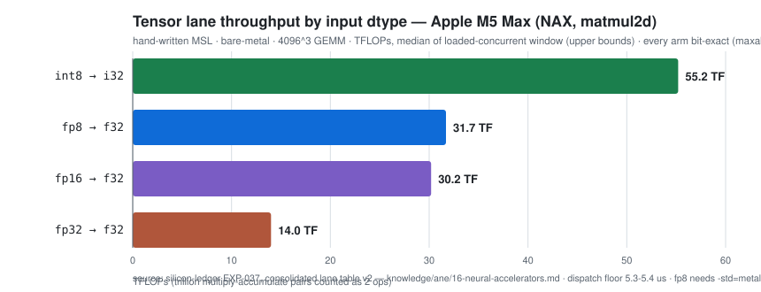

# silicon-ledger (public mirror) — every AI compute lane in Apple silicon, measured

[](LICENSE)
[](results/measurements.json)
[](PUBLIC-INDEX.md)
[](results/FLEET.md)
[](PUBLIC-OPENCLAIMS.md)

A home lab, three Macs (M4 mini, M5 Max Studio and M4 Air), one discipline: run the same
AI workloads on **every compute lane** — the Neural Engine (ANE), the GPU's
tensor units, the GPU's shader path, the CPU — and publish every number,
including the embarrassing ones, the silent detours, and the outright failures.
Nothing here is a vendor claim.

This repo is the **published mirror** of a private lab corpus, built
vibe-coding-style with AI agents under a receipts discipline: evidence and
instruments ship, scratch does not — [PUBLISH-POLICY.md](PUBLISH-POLICY.md)
spells out exactly what is public and why.

## Table of contents

- [Try it in five minutes](#try-it-in-five-minutes-any-apple-silicon-mac)
- [The numbers first](#the-numbers-first)
- [The lanes at a glance](#the-lanes-at-a-glance)
- [Six numbers that surprised us](#six-numbers-that-surprised-us)
- [What's new](#whats-new)
- [How to use this repo](#how-to-use-this-repo)
- [Why this exists](#why-this-exists)
- [What's in here](#whats-in-here)
- [The family](#the-family)
- [The house rules](#the-house-rules)
- [Challenge us](#challenge-us)
- [Cite this](#cite-this)

## Try it in five minutes (any Apple Silicon Mac)

```sh
python3 bench/identity.py
```

```json
{
 "chip": "Apple M5 Max",
 "hw_model": "Mac17,14",
 "cores": 18,
 "arch": "arm64",
 "os": "27.0.1",
 "os_build": "26A434"
}
```

One line of JSON: what machine you are on, the same identity every ledger row
carries. Now ask Apple's *private* Neural Engine framework what it exposes —
no Xcode project, no entitlement, no sudo:

```sh
cd bench && clang -O2 -o /tmp/ane-probe ane-probe.m -framework Foundation && /tmp/ane-probe | head -8
```

```text
=== AppleNeuralEngine.framework on this machine ===
  identity: chip=Apple M5 Max hw_model=Mac17,14 cores=18 arch=arm64 os=27.0.1 os_build=26A434
  dlopen: OK

=== _ANEDeviceInfo ===
      numANECores            -> 16        [I16@0:8]
      numANEs                -> 1        [I16@0:8]
      aneArchitectureType    -> h17g
```

That probe is the seed of everything below: small honest instruments, run
against the real machine, output published verbatim.

## The numbers first

Seven rows off the front page — lane comparisons, and one wall. Every cell links to the
experiment that produced it; every experiment names its measurement window and
its caveats. Rows marked *loaded-window* are declared upper bounds
(footnote [^loaded]); full window per cell in the lane table.

| lane · surface | measured | receipt |
|---|---|---|
| ANE, hand-re-authored model vs its stock export | **83 vs 10,390 mW** GPU power — 125× less, *and* faster (4.00 vs 4.33 ms) | [EXP-005](results/EXP-005-ane-residency/README.md) |
| GPU tensor units (`matmul2d`) vs hand-written shader, same 4096² | **2.26× faster**, ~2× less GPU energy | [EXP-029 matrix](results/EXP-029-nax-crosslane/results/NAX-LANE-MATRIX.md) |
| GPU vs ANE, identical fp16 GEMMs (M=1 / 512 / 2048) | GPU wins **10.2× / 7.3× / 5.4×** — including decode | [lane table §Surface 4](knowledge/ane/16-neural-accelerators.md#surface-4--ane-all-routes-raw-private-api-daemon-coreml-coreai-espresso-mailbox) |
| NAX tensor units, hand-written MSL, fp8 (loaded window[^loaded]) | **32.0 TF** @2048³, bit-exact 24/24; needs Metal 4.1 — measured | [EXP-037](results/EXP-037-fp8-nax/results/fp8_matrix-20261026T1356Z.tsv) |
| NAX, same harness, int8 (loaded window[^loaded]) | **55.2 TF** @4096³ = **1.74× the fp16/fp8 band**, bit-exact 16/16 | [EXP-037](results/EXP-037-fp8-nax/results/lane_matrix-20261026T1509Z.tsv) |
| NAX, same harness, fp32 — the first fp32 lane measurement here | **14.0 TF** @4096³, bit-exact 16/16 | [EXP-037](results/EXP-037-fp8-nax/results/lane_matrix-20261026T1509Z.tsv) |
| ANE weight budget · shared-blob private path, **both chips** | accepted **4,228,124,672 B** exact output · refused **4,294,971,392 B = 2^32+4096** (`verifyBundleAtPath Code=10`) — the wall is a 32-bit file size, not 1 GiB; **macOS 27 only**: the same h16g generation accepts ≥13.18 GiB exact on 26.6.2 | [EXP-043](results/EXP-043-m5max-weight-budget/README.md) · [EXP-044 wall log](results/EXP-044-metal-generations/raw/air-wall-26.6.2-20261027T104348Z.log) |

The full per-lane reference — every lane this fleet has measured, by surface,
with window, metric convention and instrument per cell — is
[knowledge/ane/16 §Consolidated lane table v2](knowledge/ane/16-neural-accelerators.md#consolidated-lane-table-v2--every-lane-measured-on-this-fleet-by-surface-2026-10-26-v1-same-date-superseded).
Check it **before** any speed or energy comparison; it is the single source.

[^loaded]: A loaded window means other work ran on the box during the capture,
so timings are upper bounds — declared, not hidden. Each experiment's README
names its window class (certified-quiet / clean-window / loaded / desktop).

## The lanes at a glance

One picture off the consolidated lane table — the M5 Max's GPU tensor units,
bare-metal hand-written MSL, every arm bit-exact against exact oracles:



*Loaded-concurrent window (upper bounds declared); certified-quiet re-take is
an open cell. The fp8 lane needs `-std=metal4.1` — Metal 4.0 rejects the type
(measured, not quoted) — and 4.1 code needs **macOS 27 to run**: on 26.6.2 the
same OS refuses a 4.1 metallib at load even when Xcode 27's own toolchain built
it locally (the compile gate is the Xcode generation, the runtime gate is the
OS — [EXP-044](results/EXP-044-metal-generations/README.md)).*

## Six numbers that surprised us

1. **5.3 µs** — the dispatch floor of a Neural Engine submission on this
   machine, measured across all three submission arms of the M128 ladder:
   anything you read below that is harness overhead, not compute
   ([lane table](knowledge/ane/16-neural-accelerators.md#consolidated-lane-table-v2--every-lane-measured-on-this-fleet-by-surface-2026-10-26-v1-same-date-superseded)).
2. **0 vs 19,611** — a single unprivileged IOReport counter (`ANEXL U`) that
   reads zero unless the Neural Engine is working. The only honest way to see
   Apple's silent GPU-default routing
   ([EXP-027 calibration](results/EXP-027-nax/results/p27_anpos_promote.txt)).
3. **25 → 104 mW in 30 s** — GPU idle power swings that much while *nothing
   runs*; the headless floor is ≈0–3 mW. Without this, every joule on this
   page would be noise ([QUIET-STATE](results/EXP-029-nax-crosslane/results/QUIET-STATE.md)).
4. **16 behind 1** — Apple's private framework reports **16 ANE cores**
   behind a single engine handle (architecture `h17g`); the probe in the
   quickstart above shows it on your machine in five minutes
   (`bench/ane-probe.m`). The silent lane is at least countable.
5. **1.7–8.5× slower** — the *same* GEMMs routed through Apple's generic MSL
   lowering instead of the graph path; and via that path even fp4 buys nothing
   (≤ 1.3 TF vs 32–55 TF native). Where your work goes matters more than what
   it is
   ([raw diff](results/EXP-022-m5max-baseline/raw/1427z-bench-diff-vs-example.txt)).
6. **2^32 + 4 KiB** — the actual ANE weight-file wall on both our chips: a
   4,228,124,672-byte blob loads and computes exact, and 2^32+4096 bytes gets
   refused with a 32-bit-truncation signature. The "1 GiB limit" repeated in
   guides is one chip's number, and it understates this budget ~4×
   ([EXP-043](results/EXP-043-m5max-weight-budget/README.md)). **OS-stamped
   afterthought:** that refusal appeared with macOS 27 — the same h16g ANE
   generation on 26.6.2 accepts ≥13.18 GiB with exact output, so every weight
   ceiling is an OS-version-pinned number, never a constant
   ([EXP-044](results/EXP-044-metal-generations/README.md)).

## What's new

The current round, every finding labelled **NEW / extends-public / already-public**
with its evidence link, is [**WHATSNEW.md**](WHATSNEW.md) — that page carries
the dates; this one doesn't go stale.

## How to use this repo

Three layers, by what you came for:

1. **Front door** (5 minutes) — this page, [**WHATSNEW.md**](WHATSNEW.md),
   [GLOSSARY.md](GLOSSARY.md) (house vocabulary in plain words), and
   [PUBLIC-INDEX.md](PUBLIC-INDEX.md) (every experiment in plain words).
2. **Reusable instruments** — [`bench/`](bench/) (identity probe, power A/B,
   latency protocol), [`tools/`](tools/) (the `enginemon` engine monitor, the
   instrument registry), [`schemas/`](schemas/), and
   [`CROSS-REPO-CONTRACT.md`](CROSS-REPO-CONTRACT.md) for the join with the
   benchmark repo.
3. **Receipts** (verification, deliberately verbose) —
   [`PUBLIC-OPENCLAIMS.md`](PUBLIC-OPENCLAIMS.md), `knowledge/ane/` (the
   knowledge base *and* its machine-checkable records), and the evidence under
   `results/`. Read this layer when you want to verify, not to browse.

## Why this exists

Apple's own toolchains quietly route "AI" workloads to the GPU even when you
ask for the Neural Engine — and say nothing about it. We built small
instruments to catch that happening, then learned which graphs the ANE will
accept, how much faster each lane is when it says yes, and how much the whole
picture costs in joules. Apple publishes none of this; we publish all of ours.

## What's in here

- `results/measurements.json` — every measurement ever taken, machine-checked (983 rows).
- `results/EXP-001..047` — the experiment records, one folder each (there is no `EXP-030` — that id is
  deliberately unclaimed, see the README namespace table; `EXP-038` is still in flight —
  its numbers ship in the next round). `PUBLIC-INDEX.md` maps them in plain words.
- `knowledge/ane/16-neural-accelerators.md` — the consolidated lane table: every lane measured on this fleet, by surface, single reference before any speed/energy comparison.
- `results/LADDER.md` — the five-rung summary: silicon ceiling → official overhead → port fidelity → task quality → energy.
- `results/FLEET.md` — which tool runs on which machine (and honestly, which don't).
- `MINEFIELD.md` — 20 lessons from everything that broke. Read this before debugging.
- `PUBLIC-OPENCLAIMS.md` — how our claims are recorded with receipts, and how you can verify them yourself.
- `tools/TOOLS.md` — the instrument registry: which tool is *the* one for a job (timing, joules, lane activity…).

## The family

- **[silicon-ledger-bench](https://github.com/4rg0naut/silicon-ledger-bench)** — the runnable side: burst-mode ANE/GPU/memory benchmark harnesses that emit the measurement rows this repo records. Run it yourself.
- **[memory-knowledge](https://github.com/4rg0naut/memory-knowledge)** — the claim-provenance infrastructure underneath: quote-gated capture, hash-chained ledger, the OpenClaims spine.
- **[ai-project-spine](https://github.com/4rg0naut/ai-project-spine)** — the one-file ledger gate, extracted, if you want the discipline without the lab.

## The house rules

1. Never re-run what is already recorded.
2. Every result carries its exact commands and its caveats.
3. Raw artifacts are preserved, never edited.
4. A number with no source is written as an em-dash, never guessed.

## Challenge us

Every number on this page has a click-through receipt, and every receipt has
its raw capture path. If one of them is wrong, that is a bug worth an
[issue](https://github.com/4rg0naut/silicon-ledger-public/issues) — say which
cell, which machine, and what you measured. Refutations are welcome in the
open; one of our proudest findings
([EXP-029](results/EXP-029-nax-crosslane/README.md)) is the refutation of a
widely-repeated claim, ours included.

## Cite this

```bibtex
@misc{siliconledger,
  title  = {silicon-ledger: every AI compute lane in Apple silicon, measured},
  author = {the silicon-ledger authors},
  year   = {2026},
  howpublished = {\url{https://github.com/4rg0naut/silicon-ledger-public}},
  note   = {home-lab measurement corpus; each experiment cites its capture window and raw evidence}
}
```
